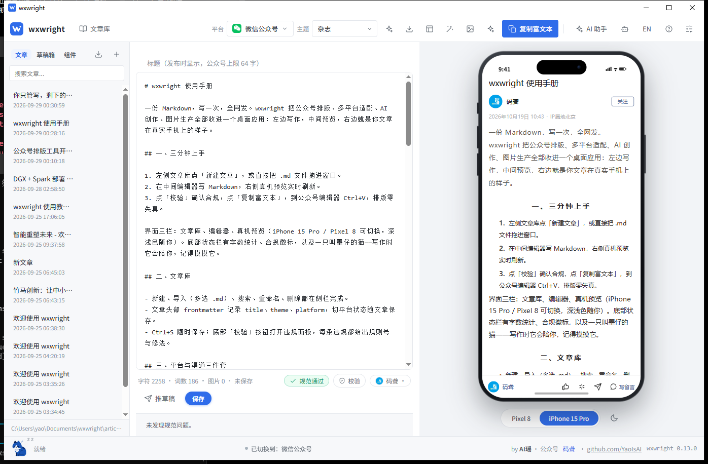
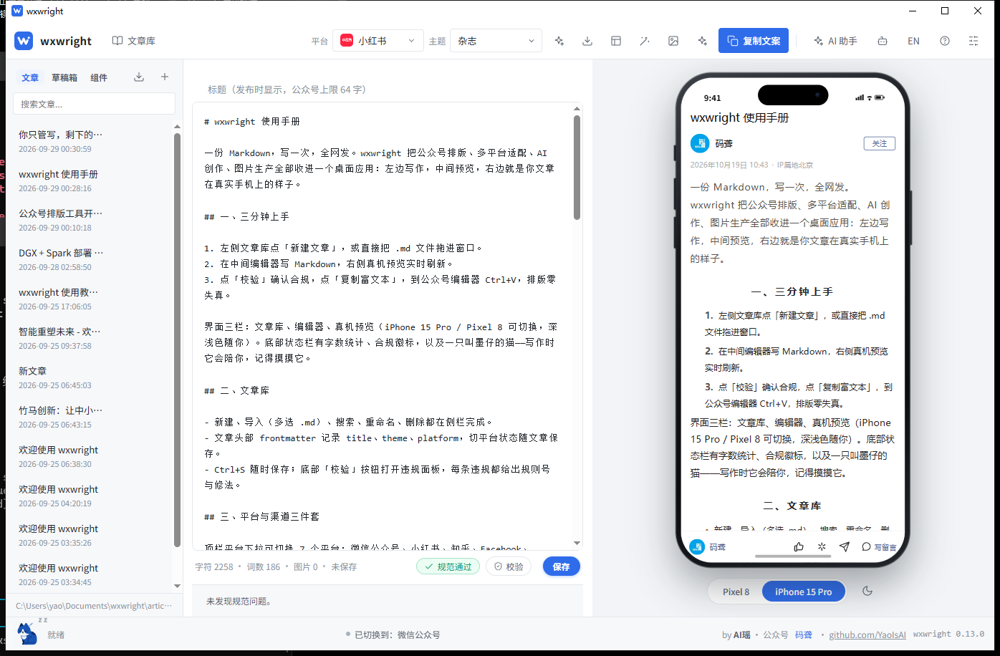
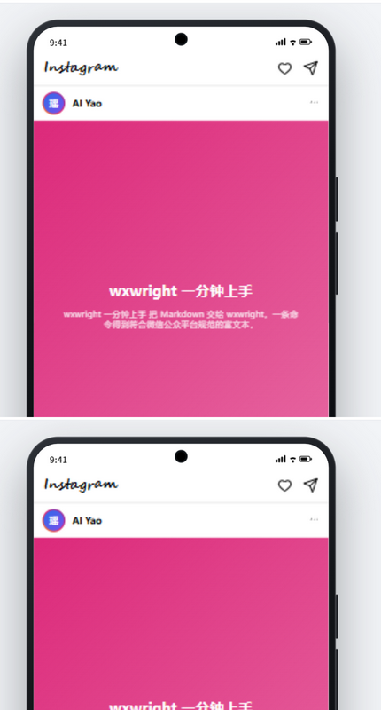
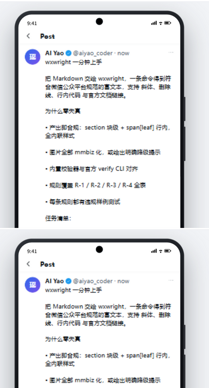
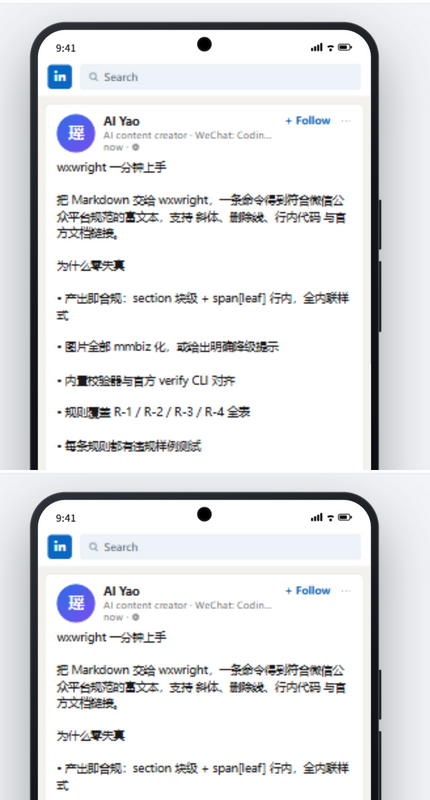
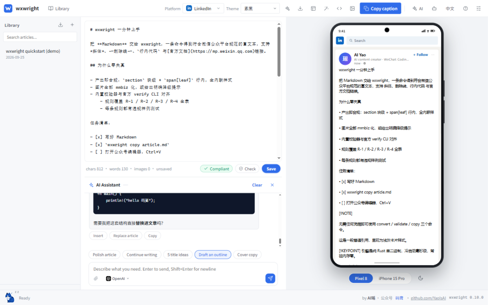
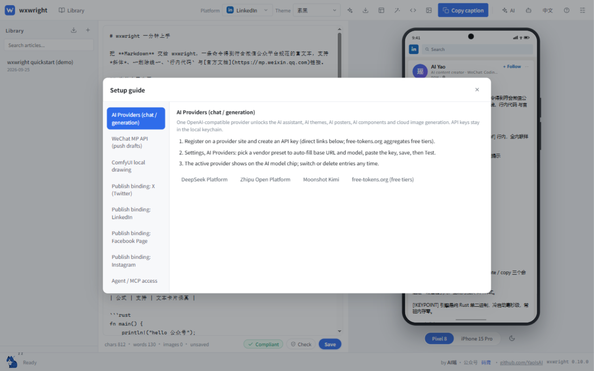

<div align="center">



# wxwright

**One Markdown, every platform.** AI-assisted writing, pixel-perfect platform previews, and WeChat-MP-compliant rich text — zero style distortion on paste.

[](https://github.com/YaoIsAI/wxwright/releases)
[](https://github.com/YaoIsAI/wxwright/actions/workflows/ci.yml)
[](#license)
[](#download)
[](https://www.rust-lang.org)

[Download](#download) · [30-second start](#30-second-start) · [For AI Agents](#for-ai-agents) · [Screenshots](#screenshots) · 简体中文见 [README.zh-CN.md](README.zh-CN.md)

</div>

wxwright is a desktop app + Rust engine for social-media writing: you write (or an AI agent writes for you) one Markdown article, and the same source is rendered, validated and exported for each platform — WeChat Official Account dialect today, Xiaohongshu / Zhihu / Facebook / Instagram / X / LinkedIn previews and export adapters built in.

## Screenshots

Every platform gets its own pixel-level preview shell, styled after the real product. Exports keep the same promise: `wxwright convert --platform xhs` produces the caption text (callouts become 【label】 lines, task items become checkmarks), `wxwright image fit --platform <id>` crops the article's images to the platform's primary cover shape, and the GUI preview shows the same shell the reader would get.

| Xiaohongshu note | Instagram post |
|:---:|:---:|
|  |  |

| X post | LinkedIn feed card |
|:---:|:---:|
|  |  |

The AI assistant drafts with you — streaming, stoppable, and every reply offers **Insert / Replace article / Copy**:



## Download

Grab an installer from the [Releases page](https://github.com/YaoIsAI/wxwright/releases) (v0.13.0):

| Platform | File |
|---|---|
| Windows | `wxwright_0.13.0_x64-setup.exe` (installer) or `wxwright-cli-windows-x64.zip` (portable CLI) |
| macOS (Apple silicon) | `wxwright_0.13.0_aarch64.dmg` (not notarized — first launch needs a one-time bypass, see below) |
| macOS (Intel) | `wxwright_0.13.0_x64.dmg` (same one-time bypass, see below) |
| Linux | `wxwright_0.13.0_amd64.deb` or `.AppImage` |
| CLI (all platforms) | `wxwright-cli-*.zip / .tar.gz` |

**macOS first launch** (macOS 11+): the dmg is ad-hoc signed but not notarized, so the first launch is blocked by Gatekeeper with "Apple could not verify that wxwright does not contain malware". After dragging `wxwright.app` to Applications, use either of these — **each needs to be done once**:

**Method 1 (recommended, one Terminal command):**

```bash
xattr -cr /Applications/wxwright.app
```

Then open normally — no prompt will appear again.

**Method 2 (no Terminal):** try to open wxwright once (it gets blocked), then open System Settings → Privacy & Security, scroll to the "Security" section, click **Open Anyway** next to the wxwright notice, authenticate with Touch ID or your password, then click **Open** in the popup. This approval also sticks permanently.

> Note: **right-click → Open** is unreliable against this gate on Apple Silicon and was removed entirely in macOS Sequoia — when blocked, just use one of the two methods above.

Same for the CLI binary after extraction: `xattr -d com.apple.quarantine wxwright`. The full signing story lives in `docs/code-signing.md`.

**Linux** (x86_64, two formats):

- deb (Debian/Ubuntu family): `sudo apt install ./wxwright_0.13.0_amd64.deb` — dependencies (libwebkit2gtk-4.1-0 / libgtk-3-0) are pulled in by apt automatically. Verified on Ubuntu 24.04: dependency resolution, end-to-end conversion of a Chinese article, and GUI launch all work.
- AppImage: `chmod +x wxwright_0.13.0_amd64.AppImage && ./wxwright_0.13.0_amd64.AppImage` (no install needed; AppDir structure and embedded binary verified).
- The Chinese UI needs a CJK font on the system: Ubuntu desktop ships one; on minimal/server installs run `sudo apt install fonts-noto-cjk` first.

Platform support at a glance: Windows 10/11 x64 · macOS 11+ (separate dmgs for Apple silicon and Intel) · Linux x86_64 (webkit2gtk-4.1).

## 30-second start

```bash
# 1. convert (no credentials needed)
wxwright convert article.md --theme minimal --out article.html

# 2. paste-safe full chain: convert -> images -> normalize -> validate -> clipboard
wxwright copy article.md
# then open the MP editor and press Ctrl+V
```

**Prefer pictures?** The [full illustrated manual](docs/tutorial.md) walks every page and every button with 18 real screenshots.

## For AI Agents

Paste the whole card from `wxwright agent-card --md` into any agent's system prompt and it can operate wxwright immediately. Machine-readable contract: `wxwright agent-card --json`.

MCP one-line integration:

```bash
wxwright mcp install --target claude   # or cursor | vscode | opencode
wxwright mcp serve                     # stdio MCP server
```

MCP tools: `wxwright_convert`, `wxwright_validate`, `wxwright_fix`, `wxwright_copy`, `wxwright_themes_list`, `wxwright_upload_images`, `wxwright_image_fit`, `wxwright_draft_create`, `wxwright_draft_update`, `wxwright_draft_list`, `wxwright_draft_delete`, `wxwright_export`.
Resources: `wxwright://themes`, `wxwright://spec/rules` (the full rule table, bilingual).
Prompts: `wxwright-publish-guide`.

Exit codes: `0` pass · `1` rule violations · `2` runtime error. All commands accept `--json` (stable schema; non-TTY defaults to JSON) and `-` for stdin.

## Why wxwright is different

The WeChat MP editor is a hardened ProseMirror variant: external stylesheets are dropped, `class`/`id` stop working, and "magic styles" (opacity-hidden images, fixed pixel widths, `height:0` collapsing) look fine in the editor but break after publishing or on mobile. Most converters optimize for the editor view; wxwright optimizes for all four views: editor, published desktop, mobile, Dark Mode.

1. **Engine, not scripts** — one pure-Rust core (`wxwright-core`) shared by CLI, MCP and GUI. Mobile FFI reuses the same brain later.
2. **Generate-then-verify** — themes render directly into the official dialect (`section` blocks + `span[leaf]` inline runs, all styles inline); the normalizer and validator are the second line of defense, not the only one.
3. **Full rule engine** — every rule of the official editor spec (PRD §5.3: R-1.1 … R-4.4) has generation strategy + auto-fix + detection, each backed by a violation-sample test. The built-in validator aligns with `verify-article-structure-spec` (official puppeteer CLI) which serves as the CI truth gate.
4. **Extreme local performance** — single static binary, zero daemon, zero IPC. Release SLO: 10k-char full chain ≤ 60 ms p50, ≤ 8 MB CLI binary (see `docs/performance.md`).

## Clipboard copy, the four zero-distortion conditions

`wxwright copy` succeeds only when all four hold (PRD §3.5):

1. Payload: self-contained `text/html`, all CSS inline, no `<style>`/`class`/`script`/external fonts.
2. Structure: the HTML already lives inside the official whitelist.
3. Images: mmbiz URLs (or explicitly accepted https with warnings); local/base64 images are **blocked** with a clear list — they would break on paste.
4. Verification: built-in validator + official CLI bridge in CI.

With credentials (`wxwright login`), local images upload to the permanent material library and are rewritten to mmbiz automatically; `wxwright draft create` then publishes straight to the 草稿箱 (Drafts).

## Themes

Three built-in themes (`minimal` 素黑 / `techblue` 科技蓝 / `magazine` 杂志). A theme is data: TOML color tokens + per-role style overrides, compiled to inline styles at render time. Roles declare **content variants** — `[block.quote.hero]` styles a one-line pull quote differently from a long citation, `[block.paragraph.lead]` gives the opening paragraph a standfirst look — the renderer classifies content at render time, and the AI theme prompt teaches the same variant table. `wxwright theme new my-theme` scaffolds one; `wxwright theme validate` proves its output compliant before it ships. `font-family` is forbidden engine-wide (official rule R-3.1) — themes cannot smuggle it in.

The GUI adds an **AI theme generator**: describe a style ("deep-space cyberpunk, neon violet on pure black"), get a brand-new theme that already passes the official rules, saved for CLI + GUI. The renderer also speaks GitHub alerts (`> [!NOTE]` / `[!TIP]` / `[!IMPORTANT]` / `[!WARNING]` / `[!CAUTION]` → callout cards), `> [!COMMENT]` comment cards, `> [!KEYPOINT] text` key-point cards, `[TOC]` directory cards, figure captions and fenced `chart` blocks — and the ```html fence (or bare block-level HTML) that passes the tag allowlist renders verbatim, so AI-generated cards land in the article as cards, not source text.

## Desktop GUI


`wxwright-gui` (Tauri 2):

- **Three-zone layout**: article library (left) / editor (center) / phone-frame preview (right), Dark Mode simulation, one-click rich copy, HTML export, `.md` drag-and-drop.
- **Title field**: the publish title lives in its own input above the body (with the MP 64-char limit as a live counter) — preview shells, exports and the drafts push all read it; the first `# H1` remains the fallback for untitled docs.
- **Article library**: local Markdown store (`Documents/wxwright/articles`) with frontmatter metadata; auto-save on switch, click to reopen, delete, new article.
- **AI assistant**: Codex-style drawer under the editor - streaming chat with any OpenAI-compatible provider (OpenAI / DeepSeek / Qwen / Kimi / GLM, or local Ollama / LM Studio). API keys live in the OS keychain. Quick prompts: polish / continue / titles / outline; every reply offers insert / replace / copy. The assistant can call the read-only MCP tools itself (validate / convert / export / themes list / drafts list) and writes rich blocks through the allowlisted HTML channel.
- **AI illustrations (one click)**: the sparkle button in the toolbar plans illustration slots from the article (anchor-verified), generates the images with your cloud image model, fits them to the target platform's shape and inserts them where they belong - the article comes back illustrated.
- **Agent integration panel** (robot icon): one-click MCP install into Claude Desktop / Cursor / VS Code / OpenCode, one-click copy of the agent card, CLI cheat sheet. Same engine, same compliance.
- **AI theme generator**: describe a style, get a brand-new theme validated against the official rules and saved for CLI + GUI.
- **Poster Studio**: HTML -> PNG locally (SVG foreignObject, offline) with all standard MP cover sizes; AI can generate the poster HTML; export-and-insert into the article.
- **Interactive SVG kit (sidebar)**: the article library's Components tab keeps 8 classic tap-to-animate WeChat SVG components at hand - slide card, envelope reveal, fade-in slogan, A/B swap, progress fill and more - as full-width thumbnail cards with one-click insert (undoable), an accordion editor with live animated preview, category filters, pin-to-top and recent-use ordering. AI generates brand-new components that ship with a parameter table (tweak the text / colors / image slots into a new variant), and image slots take an upload or an AI-generated picture; a blank editor links straight into the kit. SMIL animations follow the official R-1.7 tap rule; the engine re-validates on insert.
- **Realistic device frames**: iPhone 15 Pro (Dynamic Island, physical side keys, home indicator) and Pixel 8 (punch-hole) rendered as true hardware with an under-device switcher; dark/light toggle sits next to it. The preview scales to fit while keeping the real logical resolution. Each platform renders its real article page 1:1 — WeChat shows title → account row (bound avatar + nickname) → time/IP line → body → the bottom bar (logo, name, like / recommend / share / comment); Xiaohongshu shows cover carousel, comment block and its own action row — so you judge the final look in the app, not by test-publishing.
- **Asset library**: posters, AI paintings, pasted screenshots and dropped images all land in one managed grid (`Documents/wxwright/assets`) - thumbnail browse, one-click insert into the article, delete.
- **ComfyUI integration (local AI painting)**: wxwright auto-detects a locally running ComfyUI (default `127.0.0.1:8188`, configurable in Settings). When present, the wand button drives its API for text-to-image and image-to-image (SD workflows, queue + history polling), and outputs flow straight into the asset library and the article. The checkpoint name pulls the live model list for click-to-pick, and the launcher path gets a native file picker. No cloud, no keys.
- **Multiple WeChat accounts, one-click switching**: bind any number of Official Accounts (optional label; nickname + logo avatar are fetched automatically), and switch the active account from the avatar next to the push button - draft pushes, image uploads and the drafts box all follow it. Each account's secret lives in its own keychain slot.
- **Compliance badge** lives in the stats row (colored block/warn counts); the violations list is a static panel that never overlaps the AI drawer.
- **One-click draft-box push** (WeChat): the status row's Push-draft button renders the article with its theme, uploads local images to mmbiz, gates on blocking violations and files it into the MP drafts box. The sidebar drafts box caches the list (2-minute TTL + manual refresh), links every pushed draft back to its local article, and its Edit button reopens that article - or imports a foreign draft as a new one - so round-trip editing never duplicates.
- **Writing pet**: 墨仔 (Mozai) - an actual sitting cat with whiskers, blinking eyes and a curled tail. Bounces while you type, sleeps after 45s, hearts on click, party easter egg on triple-clicking the logo. Clicking 码聋 in the status bar pops the WeChat QR code.

The GUI binary also answers `wxwright-gui.exe mcp serve`, so a standalone GUI install works as the MCP server too.

## Publish bindings (BYO, no cloud service)

Overseas platforms use **your own** developer app - the tool ships no cloud service and stores nothing outside your machine:

- **X (Twitter)** and **LinkedIn**: one-click login is implemented end to end (OAuth 2.0 PKCE / code flow over a local loopback callback, tokens in the OS keychain), **plus live posting**: the status-row button publishes the article's caption export with fitted local images (X up to four, LinkedIn one), one click posts to every bound account, and X tokens auto-refresh. Caption export is tweet/post formatted already.
- **Facebook / Instagram**: credential interface ready; their login flows are gated by Meta app review and Instagram's public-URL media requirement (see `docs/social-publish-oauth-feasibility.md`).

Step-by-step app registration guides live behind the **? (Setup guide)** button in the top bar - including official portal links and per-platform costs (X API bills per use since 2026-02).



## Architecture

```
            ┌────────────────────────────────────────────┐
 humans ─GUI─►  hosts                                     │
 agents ─CLI─►  wxwright-gui(Tauri2)  wxwright-cli  mcp    │
 agents ─MCP─► ├────────────────────────────────────────────┤
               │  wxwright-core (pure Rust, no IO assumptions)│
               │  parser · ir · theme · render · normalizer  │
               │  validator · clipboard · imgpipeline        │
               ├────────────────────────────────────────────┤
               │  adapters: wxwright-mp (API), clipboard, img│
               └────────────────────────────────────────────┘
```

Single process, single binary, zero resident services. Boundaries are compile-time (traits + versioned DTOs); the only out-of-process exception is the optional official puppeteer check in CI.

## Security

- AppSecret lives in the OS keychain (Windows Credential Manager / macOS Keychain / libsecret); the config file stores only a reference. `WXWRIGHT_MP_APPID` / `WXWRIGHT_MP_SECRET` env vars override for CI.
- OAuth tokens for publish bindings live in the OS keychain; status payloads never contain tokens or secrets.
- Access tokens are always masked in output.
- `publish` (群发) requires explicit `--yes`; the default write path is the draft box.
- Zero telemetry, zero cloud dependencies.

## Repository map

- `crates/wxwright-core` — engine (parser, IR, dialect renderer, themes, normalizer, validator, clipboard, image pipeline, i18n, agent card)
- `crates/wxwright-cli` — CLI (also `wxwright mcp serve`)
- `crates/wxwright-mcp` — stdio MCP server (tools/resources/prompts)
- `crates/wxwright-mp` — WeChat MP API adapter (token, material upload, drafts, freepublish)
- `gui/` — Tauri 2 desktop app + vanilla-JS frontend (`ui/`)
- `tools/icongen` — icon master → platform icons pipeline
- `docs/` — agent integration, performance SLOs, manual test matrix, UI audit, publish feasibility, release automation (`release-automation.md`), Gitee mirror sync (`gitee-sync-sop.md`)
- `examples/sample-article.md` — a feature-complete sample article

## Known limitations

- Formula rendering keeps LaTeX as styled text cards (image-mode requires a KaTeX bridge, planned).
- `R-2.1` deep identical-wrapper chains are detected but not auto-unwrapped.
- Official CLI bridge (`--official-check`) prints guidance and CI instructions; the actual puppeteer run belongs to CI.
- Rich clipboard HTML flavor is attempted on Windows/macOS/Linux alike; it degrades to plain text only where the clipboard cannot accept HTML (headless).
- clap built-in help text is English; reports are localized (en / zh-CN).
- macOS builds are ad-hoc signed, not notarized (Gatekeeper blocks the first launch: `xattr -cr /Applications/wxwright.app`, or "Open Anyway" in System Settings).

## Author

**AI Yao** (AI瑶) - WeChat Official Account **码聋 (Code-Deaf)**, WeChat ID: **CodeDeafness** · [github.com/YaoIsAI](https://github.com/YaoIsAI)

Say hi to 墨仔 (Mozai), the ink cat living in the GUI status bar - and click 码聋 in the status bar to get the WeChat QR code.

<div align="center">

**Follow the Official Account**


微信扫码关注「码聋」 · WeChat ID: `CodeDeafness`

</div>

## License

MIT OR Apache-2.0
