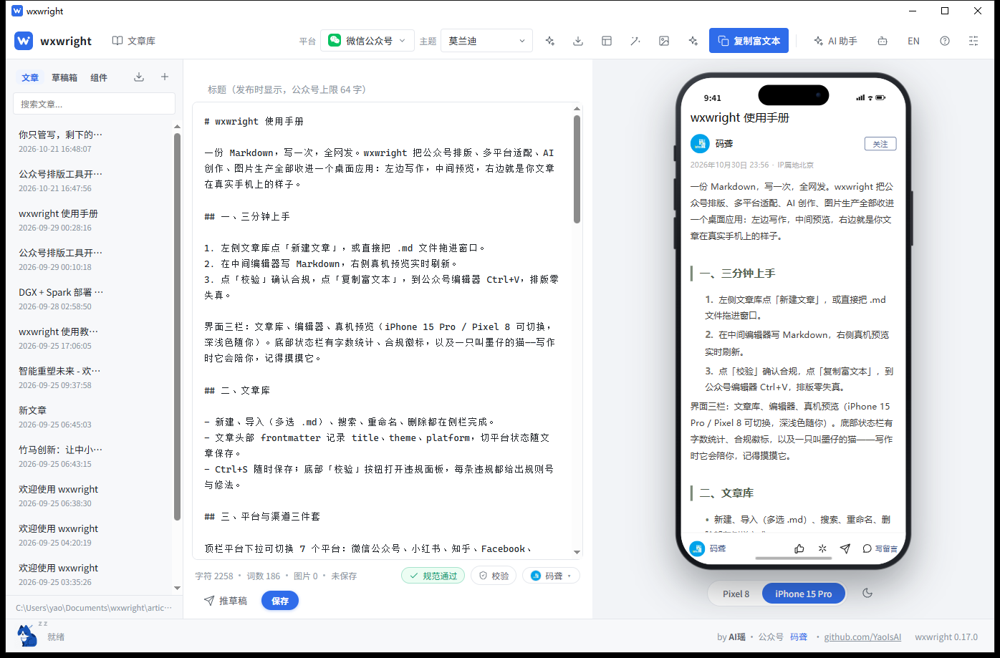
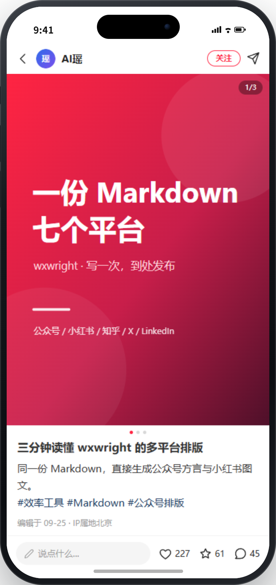
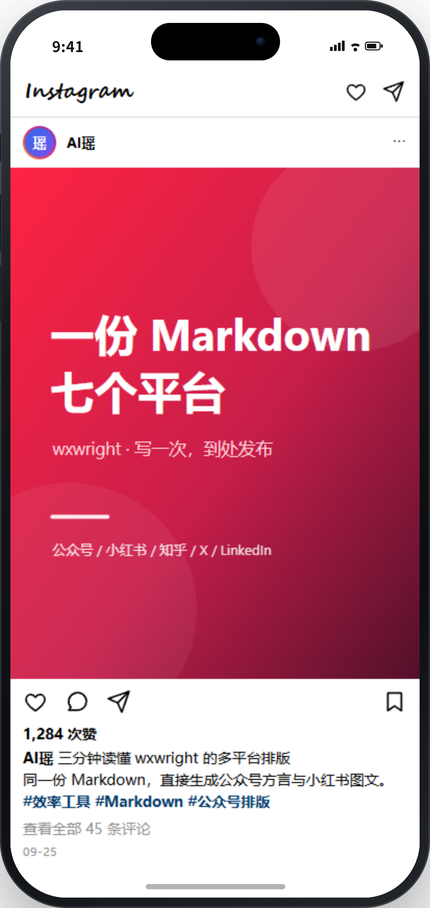
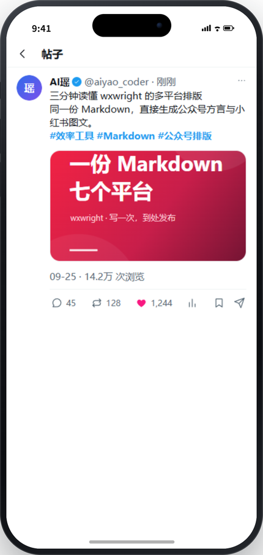
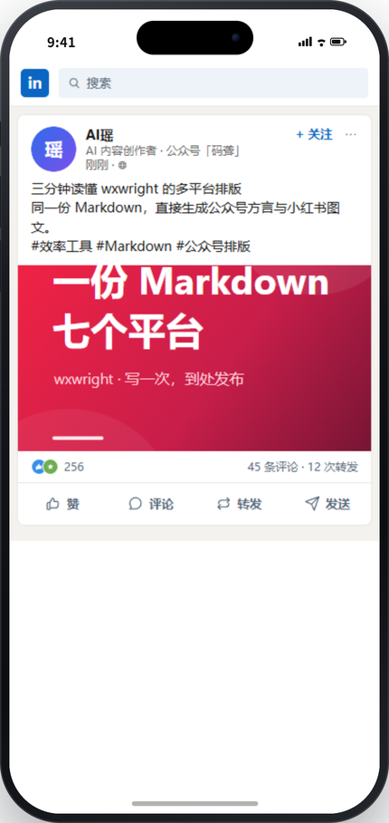
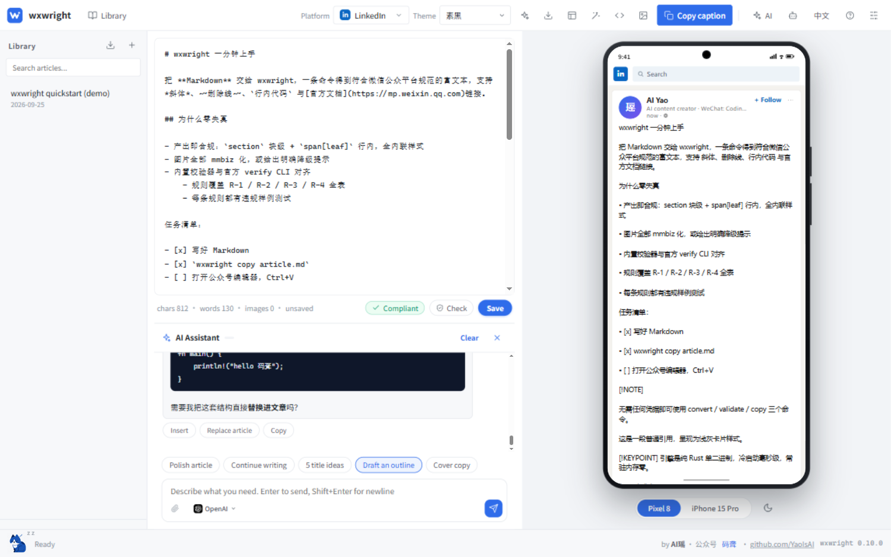

<div align="center">



# wxwright

**Write in Markdown. Publish everywhere.**

One article, seven platforms. A Rust engine renders, validates and exports the
same source for WeChat, Xiaohongshu, Zhihu, Facebook, Instagram, X and LinkedIn
- and the desktop app shows the final result before you publish.

[](https://github.com/YaoIsAI/wxwright/releases)
[](https://github.com/YaoIsAI/wxwright/actions/workflows/ci.yml)
[](#license)
[](#download)
[](https://www.rust-lang.org)

[Download](#download) - [Quick start](#quick-start) - [Why wxwright](#why-wxwright) - [Platforms](#one-source-seven-platforms) - [Features](#features) - [AI agents](#built-for-ai-agents) - [FAQ](#faq) - [中文](README.zh-CN.md)

</div>

---

wxwright is a desktop publishing studio for people who write once and ship
everywhere. Your Markdown article stays the single source of truth; the engine
turns it into each platform's native form - WeChat's strict rich-text dialect,
Xiaohongshu's image note, Zhihu's article page, or a social caption - while the
editor shows a pixel-accurate preview of the finished post.

It is built for three kinds of users:

- **Writers** who want a clean local editor with real platform previews.
- **Creators** who publish to WeChat and overseas networks from one library.
- **AI agents** that need a reliable, rules-aware conversion and publishing API.

## Why wxwright

The WeChat MP editor is a hardened ProseMirror variant: external stylesheets are
dropped, `class`/`id` stop working, and "magic styles" (opacity-hidden images,
fixed pixel widths, zero-height collapsing) look fine in the editor but break
after publishing or on mobile. Most converters optimize for the editor view.
wxwright optimizes for all four views: **editor, published desktop, mobile, and
Dark Mode**.

| | What most tools do | What wxwright does |
|---|---|---|
| **Correctness** | Generate HTML, hope the editor keeps it | Render directly into the official dialect (`section` blocks + `span[leaf]` runs, all styles inline), then normalize and validate against the full rule table |
| **Preview** | One generic phone frame | Pixel-level shells per platform, with the real account row, action bar and typography |
| **Pipeline** | A one-off script | A shared Rust core behind the GUI, CLI and MCP server - same rules, same output |
| **Images** | Paste whatever, break later | A single image gate: mmbiz URLs pass, local/base64 images are blocked with an explicit list unless uploaded first |

Three promises hold across every surface:

1. **One engine** - `wxwright-core` is pure Rust and has no IO assumptions. The
   GUI, CLI and MCP server are thin hosts over the same renderer, normalizer and
   validator.
2. **Generate-then-verify** - themes render compliant HTML from the start;
   validation is a safety net, not the only defense.
3. **No silent failures** - blocking violations stop clipboard copy and draft
   push; image problems are listed by file; update and network errors carry a
   category the UI can explain.

## Screenshots

Each platform gets its own preview shell, styled after the real product.

| Xiaohongshu note | Instagram post |
|:---:|:---:|
|  |  |

| X post | LinkedIn feed card |
|:---:|:---:|
|  |  |

The AI assistant writes beside you - streaming, stoppable, and every reply can
be inserted, used to replace the article, or copied:



## Download

Grab the latest build from the [Releases page](https://github.com/YaoIsAI/wxwright/releases).
Current version: **0.18.0**.

| Platform | File |
|---|---|
| Windows 10/11 x64 | `wxwright_0.18.0_x64-setup.exe` (per-user NSIS installer) |
| macOS 11+ (Apple silicon) | `wxwright_0.18.0_aarch64.dmg` |
| macOS 11+ (Intel) | `wxwright_0.18.0_x64.dmg` |
| Linux x86_64 | `wxwright_0.18.0_amd64.AppImage` or `wxwright_0.18.0_amd64.deb` |
| CLI only | `wxwright-cli-windows-x64.zip`, `wxwright-cli-macos-arm64.tar.gz`, `wxwright-cli-macos-x64.tar.gz`, `wxwright-cli-linux-x64.tar.gz` |

Mainland China mirror: [gitee.com/YaoIsAI/wxwright](https://gitee.com/YaoIsAI/wxwright)
(manual downloads; in-app updates use GitHub Releases).

### Updates

Installed builds check the release feed in the background. When a newer version
exists, the version number at the bottom right of the window turns into an
update button; one click downloads the signed installer, verifies its minisign
signature, installs it and restarts. Portable executables keep working as
portable files - an in-app update installs the standard per-user build
(`%LOCALAPPDATA%\wxwright`) instead of rewriting the portable copy.

The full design, signing-key setup and troubleshooting live in
[docs/auto-update.md](docs/auto-update.md).

### macOS first launch

The dmg is ad-hoc signed but not notarized, so Gatekeeper blocks the first
launch. Drag `wxwright.app` to Applications, then do **one** of the following:

```bash
xattr -cr /Applications/wxwright.app
```

or try to open the app once (it gets blocked), open **System Settings -> Privacy
& Security**, click **Open Anyway** next to the wxwright notice, authenticate,
and confirm. Both methods are one-time and permanent.

Right-click -> Open is unreliable against this gate on Apple Silicon and was
removed in macOS Sequoia. The CLI binary needs `xattr -d com.apple.quarantine
wxwright` after extraction. See [docs/code-signing.md](docs/code-signing.md)
for the full signing story.

### Linux notes

- AppImage: `chmod +x wxwright_0.18.0_amd64.AppImage && ./wxwright_0.18.0_amd64.AppImage`
- deb: `sudo apt install ./wxwright_0.18.0_amd64.deb` (apt pulls
  `libwebkit2gtk-4.1-0` and `libgtk-3-0`; verified on Ubuntu 24.04)
- The Chinese UI needs a CJK font: desktop installs usually have one; on minimal
  systems run `sudo apt install fonts-noto-cjk`.

## Quick start

### The desktop app (about a minute)

1. Launch wxwright and click **New article** (or drop a `.md` file onto the window).
2. Write or paste Markdown in the center editor; the phone on the right updates live.
3. Pick a platform and theme in the top bar.
4. Click **Check** to see rule violations, then **Copy rich text** and paste into
   the WeChat editor - or push straight to the MP drafts box.

### The CLI (about 30 seconds)

```bash
# Convert without any credentials
wxwright convert article.md --theme minimal --out article.html

# Full paste-safe chain: convert -> upload/inline images -> normalize -> validate -> clipboard
wxwright copy article.md
# then open the WeChat editor and press Ctrl+V
```

### AI agents

```bash
wxwright mcp install --target claude   # or cursor | vscode | opencode
wxwright mcp serve                     # stdio MCP server
```

Prefer a prompt? Paste the output of `wxwright agent-card --md` into any agent's
system prompt; the machine-readable contract is `wxwright agent-card --json`.

### Prefer pictures?

The [illustrated manual](docs/tutorial.md) walks through every page and button
with 18 real screenshots.

## One source, seven platforms

| Platform | Preview | Export | Rules |
|---|---|---|---|
| **WeChat MP** | Long-form article page with account row and action bar | Official rich-text dialect for clipboard + draft box API | R-1.1 ... R-4.4 (official editor spec) |
| **Xiaohongshu** | Note detail shell with cover carousel and comments | Caption text + fitted image set | XHS-1 ... XHS-5 |
| **Zhihu** | Neutral article page | Markdown | Relaxed |
| **Facebook** | Feed card | Caption + image | Platform basics |
| **Instagram** | Post shell | Caption + 4:5 / 1:1 image set | Platform basics |
| **X** | Post shell | Post text + up to four fitted images | Platform basics |
| **LinkedIn** | Feed card | Post text + one image | Platform basics |

`wxwright convert --platform <id>` and the MCP `wxwright_export` tool expose the
same exports to scripts and agents. `wxwright image fit --platform <id>` crops
the article's images to the platform's primary shape.

## Features

### Writing and rendering

- **Official dialect output** - every style inline, no external CSS, no classes;
  themes cannot smuggle forbidden properties such as `font-family` (rule R-3.1).
- **Full rule engine** - each rule has a generation strategy, an auto-fix and a
  detection check, backed by violation-sample tests.
- **GitHub alerts and rich blocks** - `> [!NOTE]`, `[!TIP]`, `[!IMPORTANT]`,
  `[!WARNING]`, `[!CAUTION]` become callout cards; `[!COMMENT]`, `[!KEYPOINT]`,
  `[TOC]`, figure captions and fenced `chart` blocks are first-class citizens.
- **Allowlisted HTML channel** - fenced `html` blocks and bare block HTML pass a
  tag allowlist and render as real cards, not source text. `img` and `a` are
  deliberately excluded so the image gate and MP link rules cannot be bypassed.
- **Themes as data** - TOML color tokens plus per-role overrides, with content
  variants (`quote.hero`, `paragraph.lead`, `table.dense`, `list.tight`,
  `code.wide`, `figure.portrait`) applied at render time.
- **AI theme generator** - describe a style, get a validated theme saved for
  both the GUI and CLI.
- **Charts and posters** - a local chart engine for data blocks, and a poster
  studio that rasterizes HTML to PNG offline for MP cover sizes.

### The desktop workspace

- Three-zone layout: article library, editor, and a device frame
  (iPhone 15 Pro / Pixel 8, light and dark).
- Article library with frontmatter (`title`, `theme`, `platform`), drag-and-drop
  import, auto-save, and a title field with the MP 64-character counter.
- One-click **Copy rich text**, HTML export, and **Push draft** straight to the
  WeChat drafts box.
- Draft box with a 2-minute cache, manual refresh, and round-trip editing: a
  pushed draft links back to its local article, and a foreign draft imports as a
  new article instead of duplicating.
- Multiple WeChat accounts, each with its own keychain slot and automatic
  nickname/avatar lookup; the active account follows the push button.
- Asset library for posters, AI images, pasted screenshots and dropped files.
- **SVG component kit** with eight tap-to-animate WeChat components, live
  parameter editing, image slots, and AI-generated variants.
- Local AI painting through ComfyUI (`127.0.0.1:8188` by default) and cloud
  image models; one-click article illustration plans anchor positions, generates
  images, fits them to the platform and inserts them.
- A writing pet, 墨仔 (Mozai), lives in the status bar. It is a cat. It blinks.

### Publishing

- **WeChat**: draft creation, image upload to the permanent material library,
  draft update, and draft-box browsing. Mass publish (`publish`) always requires
  an explicit `--yes`.
- **X and LinkedIn**: bring your own developer app. OAuth 2.0 PKCE/code flow with
  a local loopback callback, tokens in the OS keychain, live posting with fitted
  images (X up to four, LinkedIn one), and automatic X token refresh.
- **Facebook and Instagram**: credential interface ready; login flows are gated
  by Meta app review and Instagram's public-URL media requirement. See
  [docs/social-publish-oauth-feasibility.md](docs/social-publish-oauth-feasibility.md).

## Built for AI agents

The same engine is exposed as a stdio MCP server with **12 tools**:

| Area | Tools |
|---|---|
| Render | `wxwright_convert`, `wxwright_fix`, `wxwright_copy` |
| Verify | `wxwright_validate` |
| Assets | `wxwright_upload_images`, `wxwright_image_fit` |
| Publish | `wxwright_draft_create`, `wxwright_draft_update`, `wxwright_draft_list`, `wxwright_draft_delete` |
| Discover | `wxwright_themes_list`, `wxwright_export` |

Resources: `wxwright://themes`, `wxwright://spec/rules` (the full bilingual rule
table). Prompt: `wxwright-publish-guide`.

Exit codes are stable: `0` pass, `1` rule violations, `2` runtime error. Every
command accepts `--json` (non-TTY defaults to JSON) and `-` for stdin. The MCP
surface is locked by a drift test, so the server, agent card and README cannot
silently disagree.

## Auto-update pipeline

- The release workflow builds NSIS, dmg/app.tar.gz, deb and AppImage bundles,
  signs every updater artifact with minisign, and composes `latest.json`.
- The app verifies the signature with the public key compiled into the binary
  before running any installer; a bad feed or a rotated key cannot execute code.
- Signing keys live outside the repository. Without the signing secrets the
  release still publishes normal installers and the update feed stays dormant.

Details: [docs/auto-update.md](docs/auto-update.md) and
[docs/release-automation.md](docs/release-automation.md).

## Architecture

```
             +---------------------------------------------+
 humans --GUI-->  hosts                                    |
 agents --CLI-->  wxwright-gui (Tauri 2)  wxwright-cli  mcp |
 agents --MCP-->  +-----------------------------------------+
                  |  wxwright-core (pure Rust, no IO)       |
                  |  parser - ir - theme - render           |
                  |  normalizer - validator - clipboard     |
                  |  image pipeline - platform registry     |
                  +-----------------------------------------+
                  |  adapters: wxwright-mp (WeChat API),    |
                  |  OS keychain, local filesystem          |
                  +-----------------------------------------+
```

Single process, single binary, zero resident services. Boundaries are
compile-time (traits and versioned DTOs); the only out-of-process exception is
the optional official puppeteer check in CI.

## Security and privacy

- AppSecret and OAuth tokens live in the OS keychain (Windows Credential
  Manager / macOS Keychain / libsecret); the config file stores only a reference.
- Tokens and secrets are masked in logs and never returned by status commands.
- Pushing to WeChat writes a draft; mass publish requires explicit confirmation.
- Zero telemetry, zero cloud dependencies. AI providers and ComfyUI are optional
  and only contacted when you configure them.
- Update payloads are signature-verified before execution.

## FAQ

**Does wxwright upload my writing anywhere?**
No. Articles and assets are local files. Data leaves the machine only when you
call a configured AI provider, publish through a bound platform, or check for
updates.

**Do I need a WeChat Official Account?**
No for writing, previewing, conversion and export. An account (AppID + AppSecret)
is required only for image upload and draft-box publishing.

**Why not paste Markdown into the WeChat editor directly?**
The editor strips external styles and many CSS features. wxwright generates the
official dialect with inline styles and validates it before copying, which is
why the paste keeps its layout.

**Can I use it completely offline?**
Yes, except AI features and online publishing. The renderer, validator,
clipboard, themes, charts and posters run locally.

**The app says it is up to date, but a new release exists.**
Check that the release is published (not a draft or prerelease), that
`latest.json` is attached, and that a proxy is not blocking GitHub. See
[docs/auto-update.md](docs/auto-update.md).

**Windows shows "unknown publisher" / SmartScreen.**
The installer is currently unsigned. Choose "More info" then "Run anyway" if you
trust the source. Code signing activates by adding a PFX secret
([docs/code-signing.md](docs/code-signing.md)).

**Is there a mobile app?**
Not yet. The engine is pure Rust and designed to be reused; the phone frames in
the desktop app are previews, not an app.

## Development

```bash
git clone https://github.com/YaoIsAI/wxwright
cd wxwright

cargo test --workspace                 # 200+ tests; must be green
cargo run -p wxwright-cli -- convert examples/sample-article.md --out /tmp/a.html
cd gui && cargo tauri dev              # desktop app in dev mode
```

Requirements: Rust 1.96+, and on Linux the WebKitGTK 4.1 development packages
listed in [docs/release-automation.md](docs/release-automation.md). The frontend
is plain HTML/CSS/JS served from `gui/ui`; there is no Node build step.

Repository map:

| Path | Contents |
|---|---|
| `crates/wxwright-core` | Engine: parser, IR, renderer, themes, normalizer, validator, clipboard, images, platform registry, agent card |
| `crates/wxwright-cli` | CLI, including `mcp serve` |
| `crates/wxwright-mcp` | Stdio MCP server (tools, resources, prompts) |
| `crates/wxwright-mp` | WeChat MP API adapter (token, material upload, drafts, freepublish) |
| `gui/` | Tauri 2 desktop app and the vanilla-JS UI |
| `tools/` | Icon pipeline and the updater feed composer |
| `docs/` | Tutorial, agent integration, performance SLOs, signing, release and update guides |
| `examples/sample-article.md` | A feature-complete sample article |

Before changing code, read [AGENTS.md](AGENTS.md) - it records the hard
invariants, the verification flow and the pitfalls that caused past incidents.
Contributions are welcome: open an issue with the use case, keep pull requests
focused, and include test evidence.

## Known limitations

- Formula rendering keeps LaTeX as styled text cards; image mode needs a KaTeX
  bridge (planned).
- Deep identical-wrapper chains (`R-2.1`) are detected but not auto-unwrapped.
- The official puppeteer check is a CI job; the CLI prints the command and
  guidance.
- clap's built-in help is English; generated reports are English and Chinese.
- macOS builds are ad-hoc signed, not notarized.
- The GUI is desktop-only; there is no mobile client yet.

## Author

**AI Yao (AI瑶)** - WeChat Official Account **码聋 (Code-Deaf)**, WeChat ID:
**CodeDeafness** - [github.com/YaoIsAI](https://github.com/YaoIsAI)

Mozai (墨仔), the ink cat, lives in the status bar. Click 码聋 there to get the
Official Account QR code.

<div align="center">

**Follow the Official Account**


Scan with WeChat - 公众号「码聋」 - WeChat ID: `CodeDeafness`

</div>

## License

MIT OR Apache-2.0
