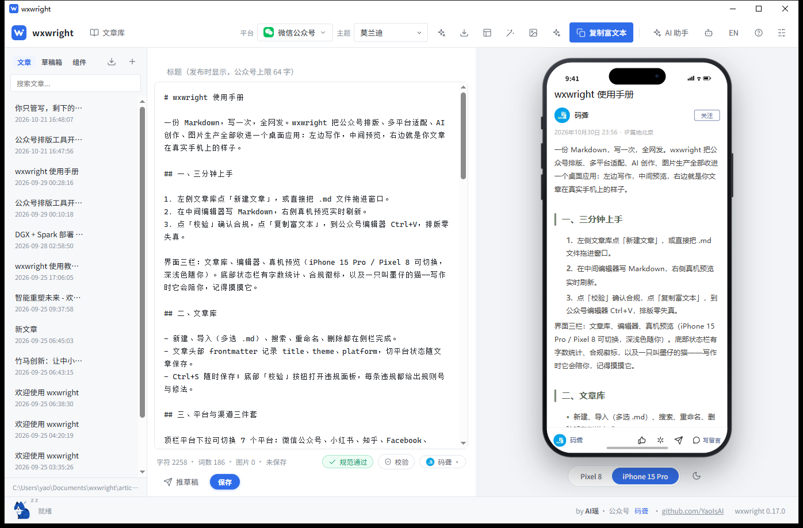
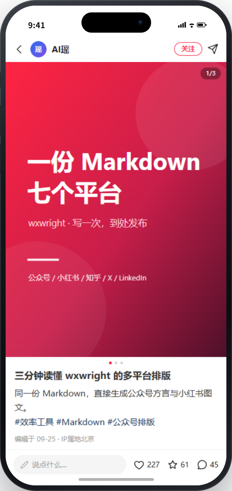
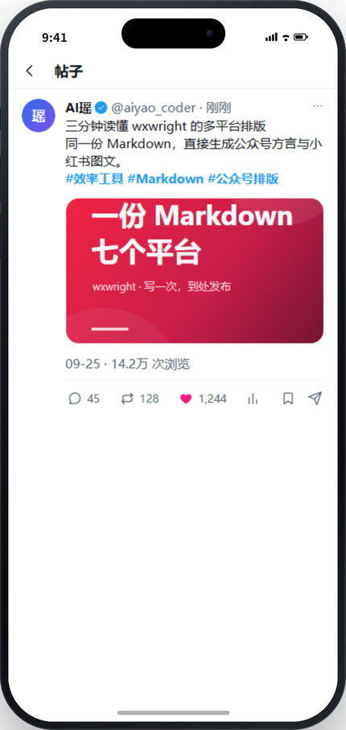
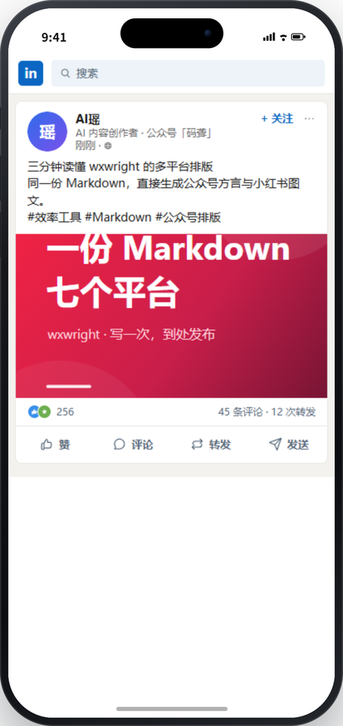
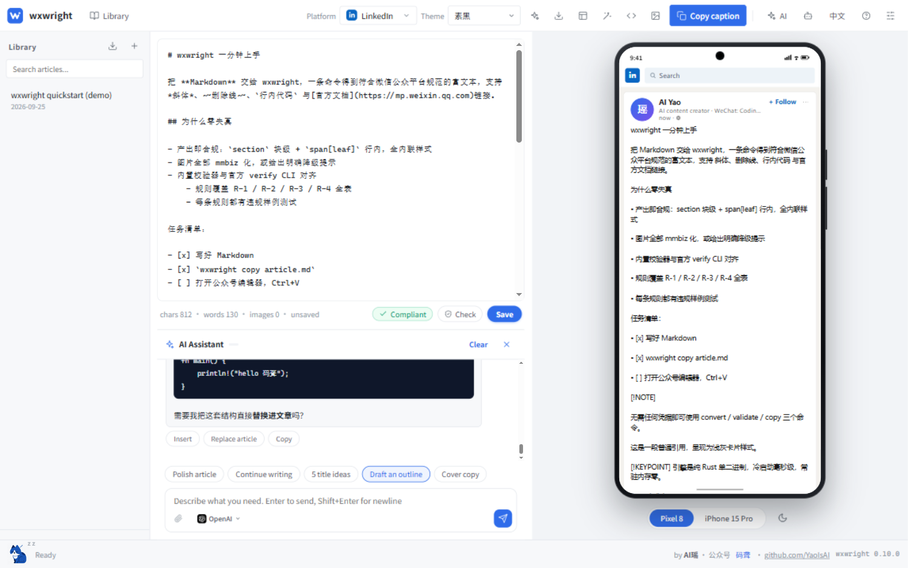

<div align="center">



# wxwright

**用 Markdown 写一次，发布到每一个平台。**

一篇稿件，七个渠道。Rust 引擎把同一份 Markdown 渲染、校验并导出为微信、
小红书、知乎、Facebook、Instagram、X、LinkedIn 各自的原生形态——桌面端在发布前
就把最终效果摆在你面前。

[](https://gitee.com/YaoIsAI/wxwright/stargazers)
[](https://gitee.com/YaoIsAI/wxwright/forks)
[](#许可证)
[](#下载)
[](https://www.rust-lang.org)

[下载](#下载) - [快速开始](#快速开始) - [为什么选-wxwright](#为什么选-wxwright) - [平台](#一份稿件七个平台) - [功能](#功能) - [AI Agent](#为-ai-agent-而生) - [常见问题](#常见问题)

</div>

---

> 本仓库为 wxwright 的 Gitee 发行仓，代码与开发主线保持同一棵提交树；
> 本页的徽章、下载与仓库链接均指向 Gitee。

wxwright 是一个「写一次、到处发布」的桌面出版工作台。Markdown 始终是唯一信源，
引擎把它转换成每个平台的原生形态——公众号严格的富文本方言、小红书图文笔记、
知乎文章页，或一条社媒文案——编辑器右侧同时给出成稿的像素级预览。

它面向三类人：

- **写作者**：想要一个干净、本地优先、带真实平台预览的编辑器。
- **内容创作者**：在一个文章库里同时打理公众号与海外平台。
- **AI Agent**：需要一套可靠、懂规则、可编程的转换与发布接口。

## 为什么选 wxwright

公众号编辑器是加固版 ProseMirror：外部样式表被丢弃，`class` / `id` 失效，大量
「魔法样式」（opacity 藏图、固定像素宽、高度塌陷）在编辑器里看着正常，发布后或
移动端直接坏掉。多数转换器只对齐编辑器视图；wxwright 对齐全部四个视图：
**编辑器、PC 已发布、移动端、Dark Mode**。

| | 多数工具 | wxwright |
|---|---|---|
| **正确性** | 先生成 HTML，再祈祷编辑器不吞 | 直接生成官方方言（`section` 块级 + `span[leaf]` 行内，全内联样式），再经过规范化与全量规则校验 |
| **预览** | 一个通用手机框 | 每个平台独立预览壳，账号行、操作栏、字号配色按真实产品还原 |
| **链路** | 一次性脚本 | 一个 Rust 引擎同时支撑 GUI、CLI、MCP，规则与输出完全一致 |
| **图片** | 先贴进去，坏了再说 | 统一图片门禁：mmbiz 地址放行，本地 / base64 图片列出清单并阻断，上传后才放行 |

三条承诺贯穿所有入口：

1. **一颗引擎** —— `wxwright-core` 是纯 Rust、无 IO 假设的引擎；GUI、CLI、MCP
   都只是薄宿主，共享同一套渲染、规范化与校验。
2. **先生成正确的，再校验** —— 主题直接渲染出合规 HTML，validator 是第二道
   防线，而不是唯一防线。
3. **不静默失败** —— 阻断级违规会拦住复制与推草稿；图片问题按文件列出；网络与
   更新错误带类别，界面能翻译成人话。

## 截图

每个平台都有自己的预览壳，按真实产品的字号与配色 1:1 还原。

| 小红书笔记 | Instagram 帖子 |
|:---:|:---:|
|  |  |

| X 帖子 | LinkedIn 信息流卡片 |
|:---:|:---:|
|  |  |

AI 助手在正文下方陪你写——流式输出、随时停止，每条回复都能插入、替换全文或复制：



## 下载

到 [发行版页面](https://gitee.com/YaoIsAI/wxwright/releases) 获取最新版本。
当前版本：**0.18.1**。

| 平台 | 文件 |
|---|---|
| Windows 10/11 x64 | `wxwright_0.18.1_x64-setup.exe`（当前用户级 NSIS 安装包） |
| macOS 11+（Apple 芯片） | `wxwright_0.18.1_aarch64.dmg` |
| macOS 11+（Intel 芯片） | `wxwright_0.18.1_x64.dmg` |
| Linux x86_64 | `wxwright_0.18.1_amd64.AppImage` 或 `wxwright_0.18.1_amd64.deb` |
| 仅 CLI | `wxwright-cli-windows-x64.zip`、`wxwright-cli-macos-arm64.tar.gz`、`wxwright-cli-macos-x64.tar.gz`、`wxwright-cli-linux-x64.tar.gz` |

发行版附件与仓库 tag 一一对应，由同一份源码构建；从 0.17.0 起，更新器产物同时
提供 minisign 签名文件（`.sig`），供应用内更新验签。

### 在线更新

安装版会在后台检查更新。发现新版本时，窗口右下角的版本号会变成更新按钮；点一下
即下载签名安装包、校验 minisign 签名、安装并自动重启。便携 exe 仍可继续便携使用
——在线更新安装的是标准的当前用户版本（`%LOCALAPPDATA%\wxwright`），不会原地
改写便携副本。

如果当前网络无法访问内置更新源，直接到上方[发行版页面](https://gitee.com/YaoIsAI/wxwright/releases)
手动下载新版本覆盖安装即可，文章库与设置不受影响。应用内检查失败时会区分
网络、清单与签名错误，不会静默失败。

完整设计、签名密钥配置与排障见 [docs/auto-update.md](docs/auto-update.md)。

### macOS 首次打开

dmg 为 ad-hoc 签名、未经 Apple 公证，首次启动会被 Gatekeeper 拦截。把
`wxwright.app` 拖进「应用程序」后，任选一种方式，**只需做一次**：

```bash
xattr -cr /Applications/wxwright.app
```

或先尝试打开一次（会被拦），然后到 系统设置 -> 隐私与安全性，在 wxwright 的提示
旁点「仍要打开」，认证后确认。两种方式都永久生效。

在 Apple Silicon 上「右键 -> 打开」并不可靠，macOS Sequoia 起该通道已被移除。
CLI 二进制解压后需要 `xattr -d com.apple.quarantine wxwright`。完整签名说明见
[docs/code-signing.md](docs/code-signing.md)。

### Linux 说明

- AppImage：`chmod +x wxwright_0.18.1_amd64.AppImage && ./wxwright_0.18.1_amd64.AppImage`
- deb：`sudo apt install ./wxwright_0.18.1_amd64.deb`（apt 自动拉取
  `libwebkit2gtk-4.1-0` 与 `libgtk-3-0`；已在 Ubuntu 24.04 实测）
- 中文界面需要系统 CJK 字体：桌面版通常自带；极简系统执行
  `sudo apt install fonts-noto-cjk`。

## 快速开始

### 桌面端（约一分钟）

1. 启动 wxwright，点「新建文章」（或把 `.md` 文件拖进窗口）。
2. 在中间编辑器写 Markdown，右侧手机框实时更新。
3. 在顶栏选平台与主题。
4. 点「校验」查看违规，再点「复制富文本」粘贴到公众号编辑器——或直接推送到草稿箱。

### CLI（约 30 秒）

```bash
# 无需任何凭据即可转换
wxwright convert article.md --theme minimal --out article.html

# 合规门禁：退出码 0 通过 / 1 存在阻断违规 / 2 未能运行
wxwright validate article.md --strict

# 可粘贴全链路：转换 -> 上传/内联图片 -> 规范化 -> 校验 -> 写剪贴板
wxwright copy article.md
# 然后打开公众号编辑器，Ctrl+V 粘贴
```

### AI Agent

```bash
wxwright mcp install --target claude   # 或 cursor | vscode | opencode
wxwright mcp serve                     # stdio MCP server
```

更喜欢提示词？把 `wxwright agent-card --md` 的输出整段贴进任意 Agent 的系统提示；
机读合同是 `wxwright agent-card --json`。

### 喜欢看图

[图文完整手册](docs/tutorial.md) 用 18 张实拍截图走遍每一个页面与按钮。

## 一份稿件，七个平台

| 平台 | 预览 | 导出 | 规则 |
|---|---|---|---|
| **微信公众号** | 长文文章页，含账号行与底部操作栏 | 官方富文本方言（剪贴板 / 草稿箱 API） | R-1.1 ... R-4.4（官方编辑器规范） |
| **小红书** | 笔记详情壳，含封面轮播与评论区 | 文案 + 按平台裁剪的图组 | XHS-1 ... XHS-5 |
| **知乎** | 中性文章页 | Markdown | 宽松 |
| **Facebook** | 信息流卡片 | 文案 + 配图 | 平台基础规则 |
| **Instagram** | 帖子壳 | 文案 + 4:5 / 1:1 图组 | 平台基础规则 |
| **X** | 帖子壳 | 帖子文案 + 最多四张裁剪图 | 平台基础规则 |
| **LinkedIn** | 信息流卡片 | 帖子文案 + 一张配图 | 平台基础规则 |

`wxwright convert --platform <id>` 与 MCP 的 `wxwright_export` 把同样的导出能力
交给脚本和 Agent；`wxwright image fit --platform <id>` 把文章图片裁到目标平台的
主形态。

## 功能

### 写作与渲染

- **官方方言输出** —— 全内联样式，无外部 CSS、无 class；主题无法夹带
  `font-family` 这类被禁属性（规则 R-3.1）。
- **全量规则引擎** —— 每条规则都有生成策略、自动修复与检测，并配有违规样例测试。
- **提示卡与富样式块** —— `> [!NOTE]`、`[!TIP]`、`[!IMPORTANT]`、`[!WARNING]`、
  `[!CAUTION]` 渲染为提示卡；`[!COMMENT]`、`[!KEYPOINT]`、`[TOC]`、图注与
  `chart` 图表块都是一等公民。
- **白名单 HTML 通道** —— fenced `html` 块与裸块级 HTML 通过标签白名单后原样
  渲染成卡片，而不是源码。`img` 与 `a` 被有意排除，防止绕过图片门禁与公众号
  链接规则。
- **主题即数据** —— TOML 色板 + 角色样式覆盖，并支持内容变体（`quote.hero`、
  `paragraph.lead`、`table.dense`、`list.tight`、`code.wide`、
  `figure.portrait`），渲染期自动判定。
- **AI 主题生成** —— 一句话描述风格，得到一套通过规则校验的主题，GUI 与 CLI 共用。
- **图表与海报** —— 本地图表引擎渲染数据块；海报工坊把 HTML 离线光栅化为 PNG，
  内置公众号封面尺寸。

### 桌面工作区

- 三栏布局：文章库、编辑器、真机预览（iPhone 15 Pro / Pixel 8，深浅色）。
- 文章库带 frontmatter（`title`、`theme`、`platform`），支持拖拽导入、自动保存，
  标题输入框带公众号 64 字上限计数。
- 一键「复制富文本」、导出 HTML、「推草稿」直通公众号草稿箱。
- 草稿箱带 2 分钟缓存与手动刷新，并支持往返编辑：推送过的草稿关联回本地文章，
  外来草稿导入为新文章，不产生重复副本。
- 多公众号绑定，每个账号独立钥匙串槽位，自动拉取昵称与头像；当前账号跟随推草稿
  按钮切换。
- 素材库统一管理海报、AI 绘图、粘贴截图与拖入文件。
- **SVG 互动组件库**：8 个点击动效组件、实时调参、图片占位、AI 生成变体。
- 本地 AI 绘图（ComfyUI，默认 `127.0.0.1:8188`）与云端图像模型；一键配图会自动
  规划插图位、生成、按平台裁剪并插入正文。
- 状态栏住着写作宠物「墨仔」。它是一只猫，会眨眼。

### 发布

- **公众号**：创建草稿、图片上传永久素材库、更新草稿、浏览草稿箱；`publish`
  走的是 freepublish（发布，把文章公开），不是群发，必须显式 `--yes`；群发仍由
  本人在公众号后台操作。
- **X 与 LinkedIn**：自带开发者应用。OAuth 2.0 PKCE / code flow + 本地回环回调，
  令牌存系统钥匙串；支持带图直接发文（X 最多四张、LinkedIn 一张），X 令牌自动
  续期。
- **Facebook 与 Instagram**：凭据接口就绪；登录流受 Meta 应用审核与 Instagram
  公网图床要求所限，详见
  [docs/social-publish-oauth-feasibility.md](docs/social-publish-oauth-feasibility.md)。

## 为 AI Agent 而生

同一颗引擎以 stdio MCP server 暴露 **12 个工具**：

| 分类 | 工具 |
|---|---|
| 渲染 | `wxwright_convert`、`wxwright_fix`、`wxwright_copy` |
| 校验 | `wxwright_validate` |
| 素材 | `wxwright_upload_images`、`wxwright_image_fit` |
| 发布 | `wxwright_draft_create`、`wxwright_draft_update`、`wxwright_draft_list`、`wxwright_draft_delete` |
| 发现 | `wxwright_themes_list`、`wxwright_export` |

资源：`wxwright://themes`、`wxwright://spec/rules`（完整双语规则表）。
提示：`wxwright-publish-guide`。

退出码稳定：`0` 通过、`1` 违规、`2` 运行异常。所有命令支持 `--json`（非 TTY
默认 JSON）与 `-` 读取 stdin。工具面由漂移测试锁定，server、agent card 与
README 不会悄悄各说各话。

## 发行与在线更新

- 发布流水线构建 NSIS、dmg / app.tar.gz、deb 与 AppImage，用 minisign 逐个签名，
  并合成 `latest.json` 清单。
- 客户端在运行安装器前用编译进二进制的公钥验签；坏掉的清单或被轮换的密钥都
  无法执行代码。
- 签名密钥只存在仓库之外；没有配置签名密钥时，构建照常产出普通安装包，
  在线更新通道保持休眠。
- 每个版本的产物与 tag 同步发布到本仓库的[发行版页面](https://gitee.com/YaoIsAI/wxwright/releases)，
  可离线下载、手动安装。

细节见 [docs/auto-update.md](docs/auto-update.md) 与
[docs/release-automation.md](docs/release-automation.md)。

## 架构

```
             +---------------------------------------------+
 人 ----GUI---->  宿主                                      |
 Agent --CLI-->  wxwright-gui (Tauri 2)  wxwright-cli  mcp   |
 Agent --MCP-->  +-----------------------------------------+
                 |  wxwright-core（纯 Rust，无 IO 假设）     |
                 |  parser - ir - theme - render            |
                 |  normalizer - validator - clipboard      |
                 |  image pipeline - platform registry      |
                 +-----------------------------------------+
                 |  适配器：wxwright-mp（公众号 API）、     |
                 |  系统钥匙串、本地文件系统                 |
                 +-----------------------------------------+
```

单进程、单二进制、零常驻服务。边界在编译期（trait + 版本化 DTO）；唯一例外是
持续集成中可选的官方 puppeteer 检查。

## 安全与隐私

- AppSecret 与 OAuth 令牌只存系统钥匙串（Windows 凭据管理器 / macOS Keychain /
  libsecret），配置文件只存引用。
- 日志与状态接口中的令牌、密钥始终掩码。
- 写公众号默认只写草稿；发布（freepublish）必须显式确认，群发不做自动化。
- 零遥测、零云端依赖。AI Provider 与 ComfyUI 都是可选项，只有你配置后才会联网。
- 更新包在执行前必须通过签名校验。

## 常见问题

**wxwright 会把我的稿子传到网上吗？**
不会。文章与素材都是本地文件。只有你调用已配置的 AI Provider、通过绑定的平台
发布，或检查更新时，数据才会离开本机。

**必须有公众号吗？**
写作、预览、转换、导出都不需要。只有图片上传与草稿箱发布需要 AppID + AppSecret。

**为什么不直接把 Markdown 粘进公众号编辑器？**
编辑器会剥离外部样式和大量 CSS 特性。wxwright 生成官方方言并先校验再复制，
所以粘贴后版式不会垮。

**可以完全离线使用吗？**
可以（AI 与在线发布除外）。渲染、校验、剪贴板、主题、图表、海报全部在本地运行。

**提示「已是最新」但确实有新版本？**
确认发行版不是预发布、附件齐全、当前网络可以访问内置更新源。若更新源不可达，
直接到[发行版页面](https://gitee.com/YaoIsAI/wxwright/releases)手动下载覆盖安装。
细节见 [docs/auto-update.md](docs/auto-update.md)。

**Windows 提示「未知发布者」/ SmartScreen 拦截？**
安装包目前未做代码签名。确认来源可信后点「更多信息」再「仍要运行」。配置 PFX
secret 即启用签名（[docs/code-signing.md](docs/code-signing.md)）。

**有移动端吗？**
暂时没有。引擎是纯 Rust、为复用而设计；桌面端里的手机框是预览，不是 App。

## 开发

```bash
git clone https://gitee.com/YaoIsAI/wxwright.git
cd wxwright

cargo test --workspace                 # 200+ 测试，必须全绿
cargo run -p wxwright-cli -- convert examples/sample-article.md --out /tmp/a.html
cd gui && cargo tauri dev              # 开发模式启动桌面端
```

要求 Rust 1.96+；Linux 还需要 `docs/release-automation.md` 中列出的 WebKitGTK 4.1
开发包。前端是 `gui/ui` 下的纯 HTML/CSS/JS，没有 Node 构建步骤。

仓库地图：

| 路径 | 内容 |
|---|---|
| `crates/wxwright-core` | 引擎：parser、IR、渲染器、主题、规范化、校验、剪贴板、图片、平台注册表、agent card |
| `crates/wxwright-cli` | CLI，含 `mcp serve` |
| `crates/wxwright-mcp` | stdio MCP server（tools / resources / prompts） |
| `crates/wxwright-mp` | 公众号 API 适配（token、素材上传、草稿、freepublish） |
| `gui/` | Tauri 2 桌面端与纯 JS 前端 |
| `tools/` | 图标管线与更新清单合成脚本 |
| `docs/` | 教程、Agent 接入、性能 SLO、签名、发布与更新指南 |
| `examples/sample-article.md` | 覆盖全部特性的示例文章 |

改代码之前请先读 [AGENTS.md](AGENTS.md)——里面记录了硬约束、验证流程和历史上
踩过的坑。欢迎贡献：先在 Issue 说明场景，PR 保持聚焦，并附上测试证据。

## 已知限制

- 公式以样式化文本卡片保真；图片模式需要 KaTeX 桥（规划中）。
- `R-2.1` 深层同样式嵌套链可检测，不自动展开。
- 官方 puppeteer 检查在持续集成中执行；CLI 只输出命令与指引。
- clap 内置 help 为英文；生成的报告支持中英双语。
- macOS 构建为 ad-hoc 签名，未经公证。
- 目前只有桌面端，没有移动客户端。

## 作者

**AI瑶** - 微信公众号 **码聋**，微信号：**CodeDeafness** -
[gitee.com/YaoIsAI](https://gitee.com/YaoIsAI)

写作宠物「墨仔」住在状态栏里；点击状态栏的「码聋」可弹出公众号二维码。

<div align="center">

**关注公众号**


微信扫码关注「码聋」 - 微信号：`CodeDeafness`

</div>

## 许可证

MIT OR Apache-2.0
